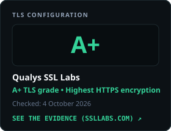
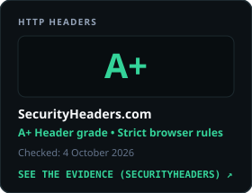
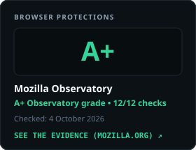
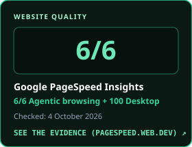
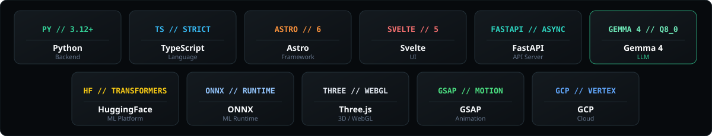



  

 

### 🛡️ Independent Verification & Agentic Readiness (`vkvstudio.com`)

<table>
  <tr>
    <td width="25%" align="center">
      
    </td>
    <td width="25%" align="center">
      
    </td>
    <td width="25%" align="center">
      
    </td>
    <td width="25%" align="center">
      
    </td>
  </tr>
</table>

---

### 🚀 Core Repositories & Production Systems

<table>
  <tr>
    <td width="50%" valign="top">
      <h3>1. <a href="https://github.com/VKVstudio/VKV_Studio_com">VKVstudio / VKV_Studio_com</a></h3>
      
<b>Bilingual Engineering Portfolio & Applied LLM Platform</b> 
      Three working LLM tools and a self-hosted, fine-tuned <b>Gemma 4</b> assistant: strict RAG grounding, QLoRA, <code>Q8_0</code> GGUF on a no-GPU ARM box. Astro 6 + Svelte 5, FastAPI, 342 automated tests.

      

        <a href="https://github.com/VKVstudio/VKV_Studio_com"><b>📂 GitHub Repository ↗</b></a> &nbsp;|&nbsp;
        <a href="https://vkvstudio.com"><b>🌐 Live Site (vkvstudio.com) ↗</b></a>
      

    </td>
    <td width="50%" valign="top">
      <h3>2. <a href="https://github.com/VKVstudio/VKV_Studio_pro">VKVstudio / VKV_Studio_pro</a></h3>
      
<b>Action-Driven AI & Engineering Editorial Platform</b> 
      Every industry update ends in a concrete action: a real benchmark test, an architectural decision, or a documented rejection. Unified sticky Reading Rail navigation across 11 industry sources.

      

        <a href="https://github.com/VKVstudio/VKV_Studio_pro"><b>📂 GitHub Repository ↗</b></a>
      

    </td>
  </tr>
  <tr>
    <td width="50%" valign="top">
      <h3>3. <a href="https://github.com/Edge0-AI/Edge0">Edge0-AI / Edge0</a></h3>
      
<b>On-Device AI & Local Model Optimization</b> 
      Compact language model workflows, quantization pipelines, and low-latency local inference infrastructure engineered for autonomous execution on consumer & edge hardware.

      

        <a href="https://github.com/Edge0-AI/Edge0"><b>📂 GitHub Repository ↗</b></a>
      

    </td>
    <td width="50%" valign="top">
      <h3>4. <a href="https://github.com/VKVstudio/StrataSmartToggle">VKVstudio / StrataSmartToggle</a></h3>
      
<b>Zero-Dependency Windows 10/11 Taskbar LLM Controller</b> 
      Lightweight native C# / WPF launcher & real-time CUDA VRAM controller built for the <code>Niko1221/Strata</code> local MoE inference engine. Instant quant switching (<code>Q8_0</code> / <code>Q2_0</code> / <code>IQ3_S</code>).

      

        <a href="https://github.com/VKVstudio/StrataSmartToggle"><b>📂 GitHub Repository ↗</b></a>
      

    </td>
  </tr>
</table>

---

### 🧱 Production Stack

  

