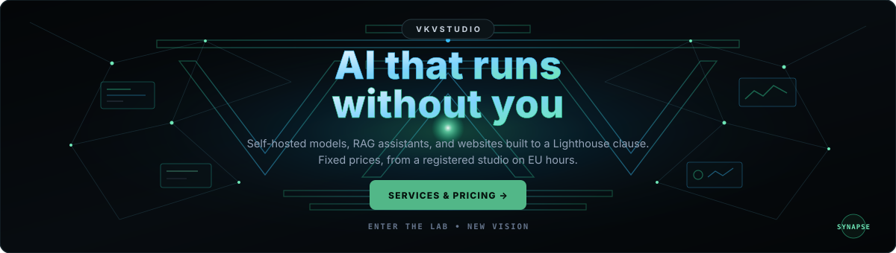



  
    
  

    &nbsp;&nbsp;
    &nbsp;&nbsp;
    
  

---

### 🛠️ Core Tech & AI Stack

  

---

### 🚀 Featured Systems & Open-Source Projects

<table>
  <tr>
    <td width="50%" valign="top">
      <h3>🌐 <a href="https://github.com/VKVstudio/VKV_Studio_com">VKV_Studio_com</a></h3>
      
<b>Bilingual Engineering Portfolio & Applied LLM Hub</b> 
      Production platform featuring working LLM tools and a self-hosted, fine-tuned Gemma assistant with strict RAG grounding, QLoRA adapters, and <code>Q8_0</code> GGUF inference on a no-gpu ARM box.

      
<code>Astro 6</code> <code>Svelte 5</code> <code>FastAPI</code> <code>RAG</code> <code>GGUF</code> • <a href="https://vkvstudio.com"><b>Live Site ↗</b></a>

    </td>
    <td width="50%" valign="top">
      <h3>⚡ <a href="https://github.com/VKVstudio/StrataSmartToggle">StrataSmartToggle</a></h3>
      
<b>Zero-Dependency Windows 10/11 Taskbar LLM Controller</b> 
      Lightweight native C# / WPF launcher & real-time CUDA VRAM monitor built for the <code>Niko1221/Strata</code> local MoE inference engine. Instant quant switching (<code>Q8_0</code> / <code>Q2_0</code> / <code>IQ3_S</code>).

      
<code>C#</code> <code>WPF</code> <code>CUDA</code> <code>Local LLM</code> <code>VRAM Control</code> • <a href="https://github.com/VKVstudio/StrataSmartToggle"><b>Repository ↗</b></a>

    </td>
  </tr>
  <tr>
    <td width="50%" valign="top">
      <h3>📰 <a href="https://github.com/VKVstudio/VKV_Studio_pro">VKV_Studio_pro</a></h3>
      
<b>Action-Driven AI & Engineering Editorial Platform</b> 
      Real-world benchmarks, architecture verification, and hands-on engineering tests across 11 industry sources with a unified sticky Reading Rail navigation system.

      
<code>Nuxt</code> <code>Python</code> <code>AI Benchmarks</code> • <a href="https://github.com/VKVstudio/VKV_Studio_pro"><b>Repository ↗</b></a>

    </td>
    <td width="50%" valign="top">
      <h3>🔥 <a href="https://github.com/VKVstudio/edge0-cuda">edge0-cuda</a> & <a href="https://github.com/VKVstudio/axioma-preview">axioma-preview</a></h3>
      
<b>On-Device AI Inference & High-Speed Web Architectures</b> 
      Low-level GPU/CUDA optimization experiments for local models alongside ultra-fast, zero-bloat web interfaces engineered for sub-second response times.

      
<code>CUDA</code> <code>On-Device AI</code> <code>Vanilla JS</code> • <a href="https://github.com/VKVstudio?tab=repositories"><b>All Repositories ↗</b></a>

    </td>
  </tr>
</table>